# WORKSHOP

## Sommaire

- ⭐
  - [Ne garder que le vert](#ne-garder-que-le-vert)
  - [Échanger les canaux](#échanger-les-canaux)
  - [Noir & Blanc](#noir--blanc)
  - [Négatif](#négatif)
  - [Dégradé](#dégradé)
  
- ⭐⭐
  - [Miroir](#miroir)
  - [Image bruitée](#image-bruitée)
  - [Rotation de 90°](#rotation-de-90)
  - [RGB split](#rgb-split)
  - [Luminosité](#luminosité)
  - [Cercle](#cercle)
  - [Animation](#animation)
  - [Mosaïque](#mosaïque)
  
- ⭐⭐(⭐)
  - [Disque](#disque)

- ⭐⭐⭐
  - [Rosace](#rosace)
  - [Glitch](#glitch)
  - [Tri de pixels](#tri-de-pixels)

- ⭐⭐⭐(⭐)
  - [Dégradés couleur](#dégradés-couleur)
  - [Tramage](#tramage)
  - [Fractale de Mandelbrot](#fractale-de-mandelbrot)

- ⭐⭐⭐⭐
  - [Mosaïque miroir](#mosaïque-miroir)
  - [Convolutions](#convolutions)
  - [Filtres séparables](#filtres-séparables)
  - [Différence de gaussiennes](#différence-de-gaussiennes)

---

## ⭐

### Ne garder que le vert

| Filtre | Base |
|:---:|:---:|
|  |  |

### Échanger les canaux

| Filtre | Base |
|:---:|:---:|
|  |  |

### Noir & Blanc

| Filtre | Base |
|:---:|:---:|
|  |  |

### Négatif

| Filtre | Base |
|:---:|:---:|
|  |  |

### Dégradé

## ⭐⭐

### Miroir

| Filtre | Base |
|:---:|:---:|
|  |  |

### Image bruitée

| Filtre | Base |
|:---:|:---:|
|  |  |

### Rotation de 90°

| Filtre | Base |
|:---:|:---:|
|  |  |

### RGB split

| Filtre | Base |
|:---:|:---:|
|  |  |

### Luminosité

| Éclaircie | Assombrie | Base |
|:---:|:---:|:---:|
|  |  |  |

### Cercle

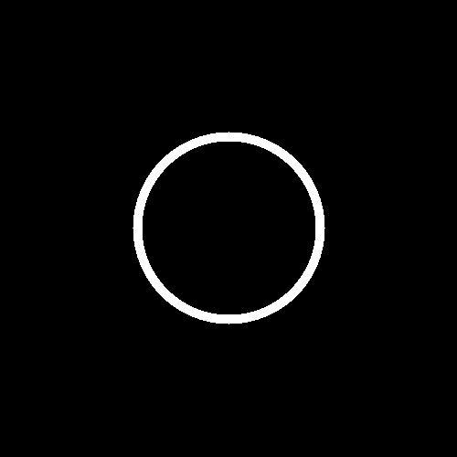

### Animation

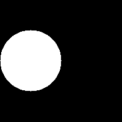

### Mosaïque

| Filtre | Base |
|:---:|:---:|
|  |  |

## ⭐⭐(⭐)

### Disque

## ⭐⭐⭐

### Rosace

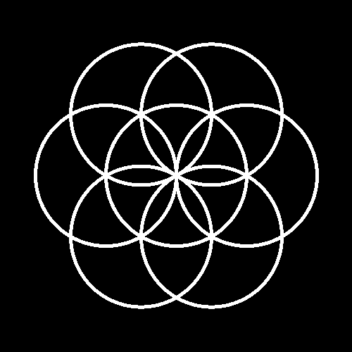

* ah ben y'avais de la trigo quoi ... mais bon ça rappelle que de bon souvenir *

### Glitch

| Filtre | Base |
|:---:|:---:|
|  |  |

### Tri de pixels

| Tous les pixels | Par ligne | Parties aléatoires | Base |
|:---:|:---:|:---:|:---:|
|  |  | 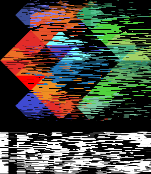 |  |

## ⭐⭐⭐(⭐)

### Dégradés couleur

| Couleur | Rouge → vert (sRGB) | Rouge → vert (Lab) |
|:---:|:---:|:---:|
| 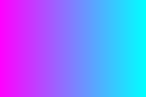 | 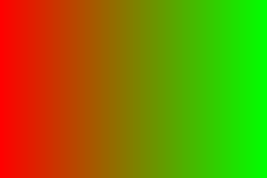 | 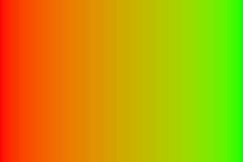 |

### Tramage

| Filtre | Base |
|:---:|:---:|
|  |  |

### Fractale de Mandelbrot

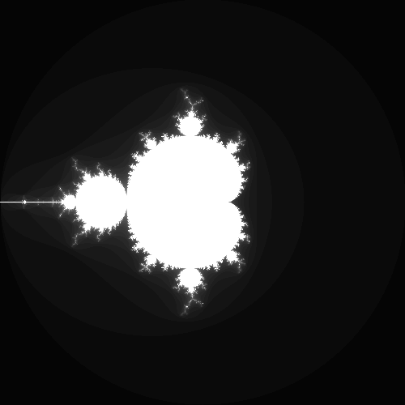

## ⭐⭐⭐⭐

### Mosaïque miroir

| Filtre | Base |
|:---:|:---:|
| 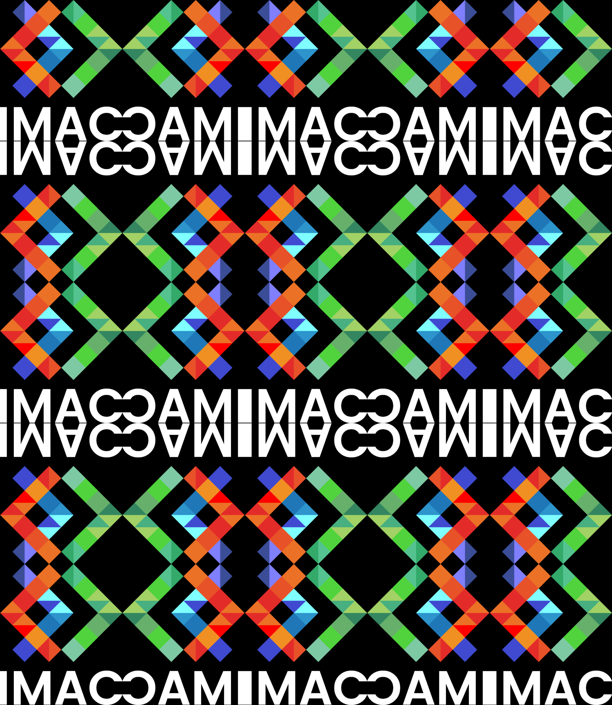 |  |

* pris du temps à décoder mathématiquement comment faire pour les miroirs mais une fois fait pas de soucis pour le code *

### Convolutions

| Box blur | Base |
|:---:|:---:|
|  |  |

### Filtres séparables

| Naïf | Séparé | Base |
|:---:|:---:|:---:|
|  | 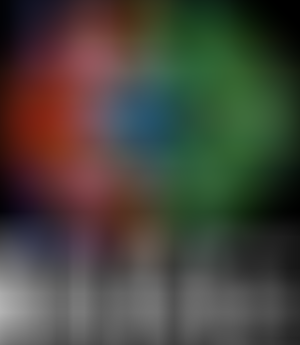 |  |

### Différence de gaussiennes

| Filtre | Base |
|:---:|:---:|
| 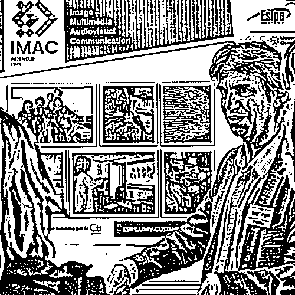 |  |
