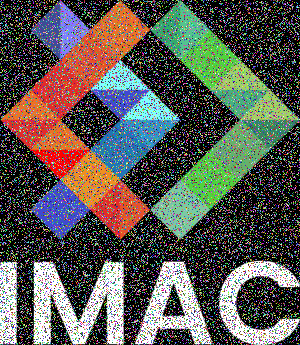
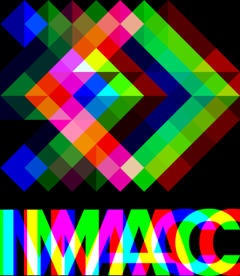
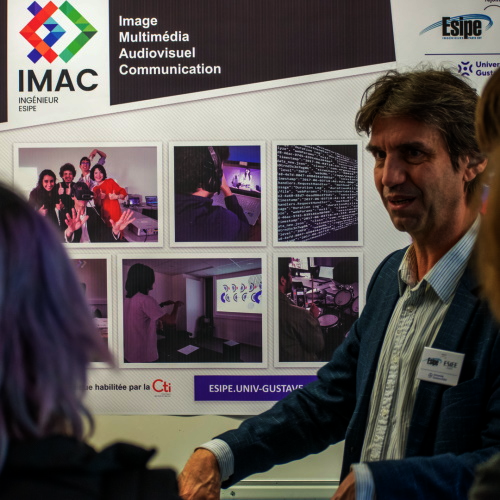
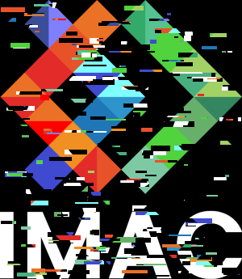

# WORKSHOP

## Sommaire

- ⭐
  - [Ne garder que le vert](#ne-garder-que-le-vert)
  - [Échanger les canaux](#échanger-les-canaux)
  - [Noir & Blanc](#noir--blanc)
  - [Négatif](#négatif)
  - [Dégradé](#dégradé)
  
- ⭐⭐
  - [Miroir](#miroir)
  - [Image bruitée](#image-bruitée)
  - [Rotation de 90°](#rotation-de-90)
  - [RGB split](#rgb-split)
  - [Luminosité](#luminosité)
  - [Cercle](#cercle)
  - [Animation](#animation)
  - [Mosaïque](#mosaïque)
  
- ⭐⭐(⭐)
  - [Disque](#disque)

- ⭐⭐⭐
  - [Rosace](#rosace)
  - [Glitch](#glitch)

- ⭐⭐⭐(⭐)
  - [Dégradés couleur](#dégradés-dans-lespace-de-couleur-lab)

- ⭐⭐⭐⭐
  - [Mosaïque miroir](#mosaïque-miroir)

---

## ⭐

### Ne garder que le vert

### Échanger les canaux

### Noir & Blanc

### Négatif

### Dégradé

## ⭐⭐

### Miroir

### Image bruitée

### Rotation de 90°

### RGB split

### Luminosité

### Cercle

### Animation

### Mosaïque

## ⭐⭐(⭐)

### Disque

## ⭐⭐⭐

### Rosace

* ah ben y'avais de la trigo quoi ... mais bon ça rappelle que de bon souvenir *

### Glitch

## ⭐⭐⭐(⭐)

### Dégradés couleur

## ⭐⭐⭐⭐

### Mosaïque miroir

* pris du temps à décoder mathématiquement comment faire pour les miroirs mais une fois fait pas de soucis pour le code *